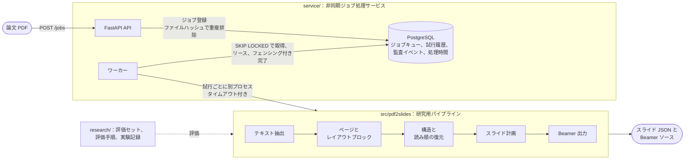

# Paper2Slides

[English](README.md) | **日本語**

[](https://github.com/tyne-less/paper2slides/actions/workflows/ci.yml)

Paper2Slides は、学術論文の PDF を構造化されたスライドに変換するプロジェクトです。リポジトリは次の 2 つで構成されています。

- **研究用パイプライン**（[`src/pdf2slides`](src/pdf2slides)、評価は [`research/`](research/README.md)）：PDF からスライドへの変換を文書理解の問題として扱い、論文の構造と読み順を復元し、そこからスライドを計画して LaTeX Beamer を出力します。途中の結果はすべてファイルとして残し、検証できるようにしています。
- **非同期ジョブ処理サービス**（[`service/`](service/README.md)）：このパイプラインを HTTP API の背後で動かします。PostgreSQL によるジョブキューで、重複排除、リトライ、タイムアウト、クラッシュからの復旧、監査ログを備え、メトリクスと負荷試験で計測しています。Google Cloud Run と Neon Postgres 上に無料枠の範囲でデプロイしています。

## 全体構成



## 主な成果

数値はすべて実測値で、計測方法はリンク先に記載しています。

| 分野 | 結果 | 詳細 |
|---|---|---|
| サービス：1 試行あたりのオーバーヘッド | 処理段階ごとの計測でプロセス起動が大半を占めることを突き止め、同じ実ジョブ 30 件で中央値を 686.6 ms から 122.2 ms に削減 | [サービスの README](service/README.md#per-attempt-overhead-measured-and-reduced) |
| サービス：負荷試験 | ワーカー 1 台、毎秒 5 リクエストを 60 秒間：600 件中失敗 0 件、`POST /jobs` の p95 は 61.6 ms、投入から完了までの p95 は 1.27 秒（ノート PC 1 台での計測のため参考値） | [`service/loadtest/RESULTS.md`](service/loadtest/RESULTS.md) |
| サービス：信頼性 | 処理中に SIGKILL で強制終了したワーカーのジョブを別のワーカーが引き継いで完了。負荷試験で見つかった不具合 2 件を修正 | [サービスの README](service/README.md#reliability) |
| サービス：デプロイ | 2026-11-20 から Cloud Run と Neon 上で稼働。投入された論文を、定期実行のワーカーが手動操作なしで処理することを確認 | [`service/deploy/README_DEPLOY.md`](service/deploy/README_DEPLOY.md) |
| 研究：構造の復元 | 8 本の論文によるベンチマークで、タイトル 8/8、アブストラクト 8/8、セクション 71/71、サブセクション 91/91 | [`research/README.md`](research/README.md#document-reconstruction-and-reading-order) |
| 研究：より難しい対象 | 段落アンカー 340/355、段落順序 291/340、図キャプション 22/23、表キャプション 35/36 | [再構成の評価ノート](research/docs/reconstruction-evaluation.md) |

## ディレクトリ構成

| パス | 内容 |
|---|---|
| [`service/`](service/README.md) | 非同期ジョブ処理サービス：API、ワーカー、キュー、マイグレーション、テスト、負荷試験、分析用 SQL、Docker Compose、Terraform |
| [`src/pdf2slides/`](src/pdf2slides) | 研究用パイプライン（Python パッケージ `pdf2slides`）とその CLI |
| [`tests/`](tests) | パイプラインのテスト |
| [`research/`](research/README.md) | 研究ノート、評価手順、評価セットの定義、実験記録、出力例 |
| [`.github/workflows/`](.github/workflows) | CI（パイプラインのテスト、サービスのテスト、lint、Terraform の検証、イメージのビルドとスモークテスト）と手動実行のデプロイ |

## クイックスタート

サービスをローカルで動かす場合（Docker が必要です）：

```bash
docker compose -f service/docker-compose.yml up --build
python service/scripts/make_sample_pdf.py sample.pdf   # pymupdf が必要。テキストレイヤーのある PDF なら何でも可
service/scripts/smoke_test.sh sample.pdf
```

API（`http://localhost:8080`、Swagger UI は `/docs`）、ワーカー、Postgres、S3 互換ストレージが起動します。スモークテストは PDF をアップロードし、ジョブの完了を待って Beamer ファイルをダウンロードします。

パイプラインをコマンドラインから直接実行する場合：

```bash
python3 -m venv .venv
source .venv/bin/activate
python3 -m pip install -e .

# pdftotext を使えるよう、Poppler を別途インストールしてください。
python3 -m pdf2slides path/to/local-paper.pdf --output-root outputs
```

Poppler は macOS では `brew install poppler`、Ubuntu や Debian では `sudo apt-get install poppler-utils` でインストールできます。実行ごとに、途中の結果がすべて出力されます。

```text
outputs/<pdf-stem>/
  01_raw_text.txt
  02_pages.json
  03_blocks.json
  04_structured_document.json
  05_slide_deck.json
  06_slides.tex
  RUN_METADATA.json
  RUN_SUMMARY.md
```

## サービス

パイプラインは複数の処理段階からなり、途中で止まる（`pdftotext` が固まるなど）、クラッシュする、特定の文書で失敗する、といったことが起こり得ます。サービスはこれを確実に、かつ状況を観測できる形で動かすためのものです。重複投入の排除、`FOR UPDATE SKIP LOCKED` で取得する PostgreSQL のジョブキュー、フェンシング付きの完了処理による at-least-once 実行、一時的なエラーに限ったジッター付き指数バックオフのリトライ、別プロセスで実行することによる試行ごとのタイムアウト、強制終了したワーカーからの復旧、グレースフルシャットダウン、すべての状態遷移の監査記録を備えています。構造化ログと Prometheus メトリクスで処理段階ごとの時間を記録し、分析用 SQL で段階別のレイテンシ分位数、エラー種別ごとの失敗、日次スループットを集計します。

アーキテクチャ、設計判断とそのトレードオフ、計測結果の詳細は [`service/README.md`](service/README.md)（英語）にあります。

## 研究

既定のパイプラインは、小さく再現可能なベースラインです。`pdftotext` でテキストを抽出し、ページとブロックの記録を作り、軽量なヒューリスティクスで構造と読み順を推定して構造化文書の JSON を出力し、スライドを計画して LaTeX Beamer のソースを出力します。ベンチマーク上、大まかな構造の復元は安定していますが、段落の境界、局所的な読み順、キャプション、数式、表、脚注は未解決の課題です。このほか、人手で作成した評価用フィクスチャ、スライド生成への影響、ソースのグルーピングについても研究しています。

結果、手法、限界については [`research/README.md`](research/README.md)（英語）にまとめています。パイプラインは研究用のプロトタイプであり、任意の論文スタイルに対する頑健性を主張するものではありません。

## 開発

```bash
python3 -m unittest discover -s tests          # パイプラインのテスト
```

サービスのテストには Postgres が必要です。手順は [`service/README.md`](service/README.md#tests-and-ci) を参照してください。評価コーパスの元 PDF や全文の書き起こしは、このリポジトリには含まれていません。
