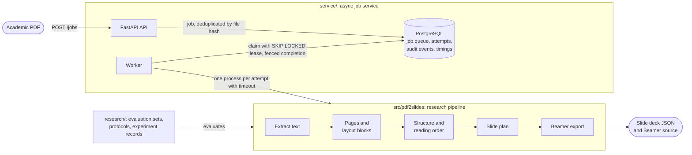

# Paper2Slides

**English** | [日本語](README.ja.md)

[](https://github.com/tyne-less/paper2slides/actions/workflows/ci.yml)

Paper2Slides turns academic PDFs into structured slide decks. The repository has two parts:

- **A research pipeline** ([`src/pdf2slides`](src/pdf2slides), evaluated in [`research/`](research/README.md))
  that treats PDF-to-slides as a document-understanding problem: recover the structure and
  reading order of a paper, plan slides from it, and export LaTeX Beamer, keeping every
  intermediate result inspectable.
- **An asynchronous job service** ([`service/`](service/README.md)) that runs the pipeline behind
  an HTTP API: a PostgreSQL job queue with deduplication, retries, timeouts, crash recovery and
  an audit trail, measured with metrics and load tests, and deployed on Google Cloud Run with
  Neon Postgres within free tiers.

## How it fits together



## Highlights

All figures are measured; each links to how it was obtained.

| Area | Result | Details |
|---|---|---|
| Service: per-attempt overhead | Median 686.6 ms → 122.2 ms on the same 30 real jobs, after per-phase timings showed that process start-up dominated | [service README](service/README.md#per-attempt-overhead-measured-and-reduced) |
| Service: load test | 1 worker at 5 requests/s for 60 s: 0 of 600 requests failed, `POST /jobs` p95 61.6 ms, submit-to-finish p95 1.27 s (one laptop, indicative only) | [`service/loadtest/RESULTS.md`](service/loadtest/RESULTS.md) |
| Service: reliability | A worker killed with SIGKILL mid-job is recovered by another worker; 2 bugs found by load testing were fixed | [service README](service/README.md#reliability) |
| Service: deployment | Running on Cloud Run + Neon since 2026-11-20; a scheduled worker run processed a submitted paper with no manual step | [`service/deploy/README_DEPLOY.md`](service/deploy/README_DEPLOY.md) |
| Research: structure recovery | On an eight-paper benchmark: title 8/8, abstract 8/8, sections 71/71, subsections 91/91 | [`research/README.md`](research/README.md#document-reconstruction-and-reading-order) |
| Research: harder targets | Paragraph anchors 340/355, paragraph order 291/340, figure captions 22/23, table captions 35/36 | [reconstruction note](research/docs/reconstruction-evaluation.md) |

## Repository map

| Path | What it is |
|---|---|
| [`service/`](service/README.md) | The async job service: API, worker, queue, migrations, tests, load tests, analytics SQL, Docker Compose, Terraform |
| [`src/pdf2slides/`](src/pdf2slides) | The research pipeline (Python package `pdf2slides`) and its CLI |
| [`tests/`](tests) | Tests for the pipeline |
| [`research/`](research/README.md) | Research notes, evaluation protocols, evaluation-set definitions, experiment records and an example output |
| [`.github/workflows/`](.github/workflows) | CI (pipeline tests, service tests, lint, Terraform validation, image build with smoke test) and a manual deploy workflow |

## Quick start

Run the service locally (requires Docker):

```bash
docker compose -f service/docker-compose.yml up --build
python service/scripts/make_sample_pdf.py sample.pdf   # needs pymupdf; any text-layer PDF works
service/scripts/smoke_test.sh sample.pdf
```

This starts the API on `http://localhost:8080` (Swagger UI at `/docs`), a worker, Postgres and an
S3-compatible store; the smoke test uploads the PDF, waits for the job and downloads the Beamer
file.

Or run the pipeline directly from the command line:

```bash
python3 -m venv .venv
source .venv/bin/activate
python3 -m pip install -e .

# Install Poppler separately so `pdftotext` is available on PATH.
python3 -m pdf2slides path/to/local-paper.pdf --output-root outputs
```

On macOS, install Poppler with `brew install poppler`; on Ubuntu or Debian, use
`sudo apt-get install poppler-utils`. Each run writes every intermediate artifact:

```text
outputs/<pdf-stem>/
  01_raw_text.txt
  02_pages.json
  03_blocks.json
  04_structured_document.json
  05_slide_deck.json
  06_slides.tex
  RUN_METADATA.json
  RUN_SUMMARY.md
```

## The service

The pipeline is a sequence of stages that can hang (a stuck `pdftotext`), crash, or fail on one
document. The service makes running it reliable and observable: deduplicated submissions, a
PostgreSQL queue claimed with `FOR UPDATE SKIP LOCKED`, at-least-once execution with fenced
completion, retries with jittered backoff for transient errors only, per-attempt timeouts in a
separate process, recovery after a killed worker, graceful shutdown, and an audit row for every
status change. Structured logs and Prometheus metrics record each processing phase; analytics
SQL reports stage latency percentiles, failures by error type and daily throughput.

Architecture, design decisions with their trade-offs, and all measurements:
[`service/README.md`](service/README.md).

## The research

The default pipeline is a compact, reproducible baseline: it extracts text with `pdftotext`,
builds page and block records, applies lightweight structure and reading-order heuristics,
writes a structured document JSON file, plans a slide deck, and exports LaTeX Beamer source.
High-level structure recovery is stable on the benchmark; paragraph boundaries, local reading
order, captions, formulas, tables and footnotes remain the open problems. The research also
covers human-authored evaluation fixtures, downstream slide generation and source grouping.

Results, methods and limitations: [`research/README.md`](research/README.md). The pipeline is a
research prototype; it does not claim robust performance across arbitrary publication styles.

## Development

```bash
python3 -m unittest discover -s tests          # pipeline tests
```

Service tests need Postgres; see [`service/README.md`](service/README.md#tests-and-ci). The
repository contains no source PDFs or full transcriptions from the evaluation corpus.
